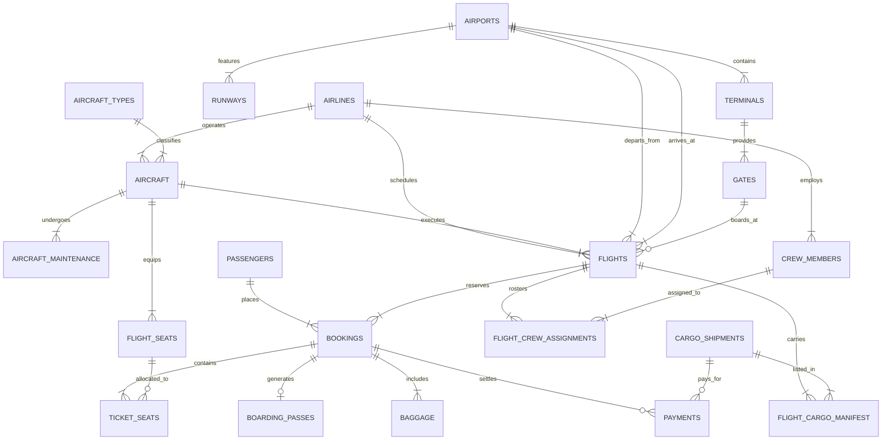

# Academic DBMS Project Report
## Topic: Airport & Airline Passenger and Cargo Logistics Management System

---

**Degree:** Bachelor of Technology (B.Tech) in Computer Science & Engineering  
**Subject:** Database Management Systems (CS-302 / CS-501)  
**Academic Year:** Final Year Submission  
**Database System:** MySQL 8.0+ Only  
**Project Location:** `airport_cargo_dbms/`  

---

## Table of Contents
1. [PART 1: PROJECT FOUNDATION](#part-1-project-foundation)
   - 1.1 Problem Statement
   - 1.2 Objectives
   - 1.3 Scope of the System
   - 1.4 System Limitations
   - 1.5 System Users & Stakeholders
2. [PART 2: SYSTEM FEATURES & REQUIREMENTS](#part-2-system-features--requirements)
   - 2.1 Passenger Management Features
   - 2.2 Airline & Airport Operations Features
   - 2.3 Cargo Logistics Management Features
   - 2.4 Administrative, Financial & Audit Features
3. [PART 3: DATABASE DESIGN & ARCHITECTURE](#part-3-database-design--architecture)
   - 3.1 Entity-Relationship (ER) Identification
   - 3.2 Cardinality & Participation Constraints
   - 3.3 ER Diagram (Mermaid & dbdiagram.io DSL)
   - 3.4 Relational Schema Mapping
   - 3.5 Step-by-Step Normalization (0NF to 3NF)
   - 3.6 Data Dictionaries (All 22 Tables)
4. [PART 4: SQL IMPLEMENTATION & ANALYTICS](#part-4-sql-implementation--analytics)
   - 4.1 Schema DDL Summary
   - 4.2 Automation via Triggers & Views
   - 4.3 Advanced SQL Analytical Queries
   - 4.4 Role-Based Access Control (RBAC) Implementation
5. [PART 5: CONCLUSION & FUTURE ENHANCEMENTS](#part-5-conclusion--future-enhancements)

---

# PART 1: PROJECT FOUNDATION

## 1.1 Problem Statement

Modern international and domestic aviation hubs handle thousands of commercial flights, tens of thousands of passengers, and hundreds of metric tons of cargo daily. Historically, regional air operators and airport authorities relied on decentralized spreadsheet models (e.g., Microsoft Excel workbooks) and legacy isolated file systems.

### Critical Failures of Legacy Spreadsheet & File-Based Systems:
1. **Data Redundancy & Inconsistency:** The same passenger or cargo record was duplicated across flight dispatch, baggage handling, and customs sheets. Updating a passenger’s passport number in one spreadsheet left older copies intact in other departments, leading to manifest mismatches.
2. **Lack of Transactional Integrity (ACID Guarantees):** Concurrent seat selection or cargo space reservation resulted in double-booking errors. Spreadsheets lack atomic row-level locking during simultaneous access by ground staff and booking agents.
3. **No Automated Constraint Enforcement:** Spreadsheet cells allowed invalid inputs (e.g., negative baggage weight, invalid IATA codes, scheduling departure after arrival, or assigning crew members who exceeded maximum duty hours).
4. **Customs & Regulatory Security Risks:** International cargo logistics requires strict verification before loading. Uncoordinated spreadsheet updates resulted in uninspected hazardous cargo being loaded onto passenger aircraft.
5. **Absence of Auditability & Access Control:** Legacy files lack granular role-based access control. Any user with file access could overwrite flight schedules or purge financial payment logs without leaving an audit footprint.

### Solution:
The **Airport & Airline Passenger and Cargo Logistics Management System** resolves these critical bottlenecks by introducing a centralized, multi-tenant Relational Database Management System (RDBMS). Built on normalized relational tables with declarative foreign keys, triggers, declarative `CHECK` constraints, and role-based views, the system provides ACID-compliant real-time synchronization across passenger booking, flight operations, crew scheduling, and customs cargo clearance.

---

## 1.2 Objectives

1. **Centralize Aviation Operations:** Unify passenger registration, ticket reservation, gate allocation, fleet maintenance, crew duty tracking, and heavy air freight into a single coherent database schema.
2. **Enforce Structural Data Integrity:** Enforce foreign key constraints, unique natural identifiers (IATA, ICAO, Passport, PNR, Air Waybill AWB), and check constraints on flight times and payload capacities.
3. **Optimize Gate & Runway Scheduling:** Eliminate temporal gate assignment clashes by maintaining normalized terminal, gate, and flight relationship structures.
4. **Streamline Cargo Logistics & Customs Compliance:** Track cargo shipments from booking through depot storage, customs inspection, flight loading manifest creation, and final destination delivery.
5. **Enforce Aviation Safety Rules:** Enforce maximum flight crew duty hours ($\le 14$ hours per rostered shift) and prevent aircraft overload by calculating remaining payload capacity prior to loading.
6. **Ensure Regulatory Security & Auditability:** Maintain an immutable audit log of flight status changes, gate reassignments, and customs inspections.

---

## 1.3 Scope of the System

The scope of this DBMS project encompasses:
- **International & Domestic Airport Coverage:** Support for multiple origin and destination hubs (e.g., DEL, BOM, BLR, DXB, LHR).
- **Fleet Management:** Fleet categorization (Airbus A320neo, Boeing 777-300ER, A350-900) with technical specifications (seat capacity, payload weight/volume limits).
- **Passenger Lifecycle Management:** Passenger registration, PNR ticket creation, dynamic seat assignment, baggage tagging, boarding pass generation, and loyalty point rewards.
- **Cargo Freight Pipeline:** Air Waybill (AWB) generation, weight/volume tracking, special cargo classification (Perishable, Fragile, Hazardous, Live Animals), and customs clearance workflow.
- **Crew Roster & Maintenance Logging:** Roster creation with duty-hour tracking and aircraft maintenance lifecycle management.
- **Multi-Role Security:** Security policies for System Admins, Airline Operations, Ground Crew, Cargo Handlers, Customs Officers, and Passengers.

---

## 1.4 System Limitations

While comprehensive, the current system design operates under the following boundary conditions:
1. **Simplified Financial Gateway:** Financial payment transactions are recorded inside the database, but real-time integration with external banking APIs (e.g., Stripe, SWIFT network) is simulated.
2. **Static Geo-Fencing:** Runway coordinates and GPS coordinates are stored as stationary attributes without live radar telemetry integration (ADS-B stream ingestion).
3. **Simulated Weather Delays:** Flight delay reasons are logged manually by dispatchers rather than auto-populated by automated METAR weather sensors.

---

## 1.5 System Users & Stakeholders

| User Role | Target User | System Responsibilities & Permissions |
|---|---|---|
| **System Admin** | Airport IT Administrator | Full read/write access, database maintenance, user provisioning, audit log review. |
| **Airline Staff** | Flight Operations Dispatcher | Flight scheduling, fleet assignment, ticket bookings, passenger profiles, crew roster. |
| **Ground Staff** | Gate & Baggage Controller | Gate allocation, passenger check-in, boarding pass generation, baggage scanning. |
| **Cargo Handler** | Logistics Bay Supervisor | Cargo intake, weighing, cargo bay assignment, flight manifest loading. |
| **Customs Officer** | Government Inspector | Cargo customs inspection, clearance status updates (Cleared/Held/Rejected). |
| **Passenger** | Traveler | View public flight schedules, personal PNR bookings, baggage tracking status. |

---

# PART 2: SYSTEM FEATURES & REQUIREMENTS

## 2.1 Passenger Management Features
- **Passenger Profile Management:** Secure registration capturing primary passport numbers, nationality, contact details, and frequent flyer IDs.
- **Flight Discovery:** Query flights by origin/destination IATA code, date, and operating carrier.
- **PNR Booking & Seat Inventory:** Reservation of specific seat numbers (`12A`, `01B`) across Economy, Business, and First class with seat map conflict prevention.
- **Check-in & Boarding Pass Issue:** Conversion of reserved tickets to checked-in status, allocating sequential boarding passes tied to operational departure gates.
- **Baggage Tracking:** Individual baggage tag creation (`BAG-DEL-98124`) with automatic excess weight detection ($> 15$ kg domestic / $> 23$ kg int'l) and fee calculation.
- **Loyalty Rewards Engine:** Automated trigger-based point calculation ($\lfloor \text{Booking Amount} / 100 \rfloor$) upon booking confirmation.

## 2.2 Airline & Airport Operations Features
- **Infrastructure Hierarchy:** Multi-tier mapping from Airport $\rightarrow$ Terminal $\rightarrow$ Gate / Runway.
- **Fleet Allocation & Maintenance:** Aircraft status tracking (`Active`, `In Maintenance`, `Grounded`) linked to maintenance logs (Routine, Engine Overhaul, C-Check).
- **Flight Dispatch Roster:** Log scheduled departure/arrival vs actual timestamps, reason for delay, and gate assignments.
- **Crew Roster & Safety Rules:** Pilot and cabin crew flight assignment with auto-generated duty-hour calculation enforcing safety rules.

## 2.3 Cargo Logistics Management Features
- **Air Waybill (AWB) Booking:** Cargo registration specifying shipper, receiver, cargo category (General, Perishable, Fragile, Hazardous, Live Animals), declared value, weight (kg), and volume ($m^3$).
- **Payload Capacity Check:** System checks remaining cargo weight and volume limits of the assigned aircraft model before manifesting.
- **Customs Inspection Pipeline:** Multi-stage customs clearance state machine (`Pending Inspection` $\rightarrow$ `Cleared` / `Held` / `Rejected`).
- **Shipment Status Tracking:** Live lifecycle tracking (`Booked` $\rightarrow$ `Received at Depot` $\rightarrow$ `Loaded` $\rightarrow$ `In-Air` $\rightarrow$ `Customs Clearance` $\rightarrow$ `Delivered`).

## 2.4 Administrative, Financial & Audit Features
- **Payment Settlement:** Recording payment methods (Credit Card, UPI, Wire Transfer), transaction IDs, and linking payments to bookings or freight AWBs.
- **Automated Audit Logging:** Trigger-based capture of critical state changes (flight delays, gate reassignments, customs decisions) storing `user_id`, `old_value`, `new_value`, and `timestamp`.
- **Role-Based Access Control (RBAC):** SQL DCL role definitions ensuring data segregation across organizational boundaries.

---

# PART 3: DATABASE DESIGN & ARCHITECTURE

## 3.1 Entity-Relationship (ER) Identification

The system comprises **22 core entities** grouped into 5 logical subsystems:

1. **`system_users`**: User credentials, roles, and status.
2. **`audit_logs`**: Immutable audit logs of administrative actions.
3. **`airports`**: Master registry of global airports (DEL, BOM, BLR, DXB, LHR).
4. **`terminals`**: Terminal buildings per airport.
5. **`gates`**: Departure and arrival boarding gates.
6. **`runways`**: Runway strips with length and surface specifications.
7. **`airlines`**: Operating air carriers (Air India, IndiGo, Emirates, British Airways).
8. **`aircraft_types`**: Aircraft manufacturer specs, max seats, max cargo payload.
9. **`aircraft`**: Individual tail-numbered planes (e.g. VT-ALX, A6-EGB).
10. **`aircraft_maintenance`**: Service and overhaul logs per aircraft.
11. **`passengers`**: Passenger personal details, passport, loyalty numbers.
12. **`flights`**: Scheduled flight instances connecting origin and destination airports.
13. **`flight_seats`**: Individual seat grid layout per aircraft model.
14. **`bookings`**: PNR passenger reservations.
15. **`ticket_seats`**: Reserved seats linked to PNR bookings.
16. **`boarding_passes`**: Boarding documents issued at check-in.
17. **`baggage`**: Checked luggage tags and weight logs.
18. **`crew_members`**: Flight crew employee records and license numbers.
19. **`flight_crew_assignments`**: Roster mapping crew to specific flights.
20. **`cargo_shipments`**: Freight shipments with Air Waybill identifiers.
21. **`flight_cargo_manifest`**: Belly-hold cargo placement mapping per flight.
22. **`payments`**: Payment transaction logs.

---

## 3.2 Cardinality & Participation Constraints

- **Airport to Terminal:** $1 : N$ (One airport has many terminals. Mandatory participation on Terminal side).
- **Terminal to Gate:** $1 : N$ (One terminal has many gates).
- **Airline to Aircraft:** $1 : N$ (One airline operates multiple aircraft).
- **Aircraft Type to Aircraft:** $1 : N$ (One type/model classifies multiple aircraft).
- **Aircraft to Flight:** $1 : N$ (One aircraft operates many scheduled flights over time).
- **Flight to Booking:** $1 : N$ (One flight contains many passenger bookings).
- **Passenger to Booking:** $1 : N$ (One passenger can create multiple PNR bookings).
- **Booking to Ticket Seat:** $1 : N$ (One booking PNR can cover multiple passenger seats).
- **Booking to Baggage:** $1 : N$ (One booking can have multiple checked baggage items).
- **Flight to Crew (via `flight_crew_assignments`):** $M : N$ (A flight requires multiple crew; a crew member works multiple flights).
- **Flight to Cargo (via `flight_cargo_manifest`):** $M : N$ (A flight carries multiple cargo AWBs; an AWB can be multi-leg).

---

## 3.3 ER Diagram

### 3.3.1 Mermaid ER Diagram Code


### 3.3.2 dbdiagram.io DSL Code
```dbml
// Paste this code directly into https://dbdiagram.io

Table airports {
  airport_id int [pk, increment]
  iata_code varchar(3) [unique, not null]
  icao_code varchar(4) [unique, not null]
  name varchar(150) [not null]
  city varchar(100) [not null]
  country varchar(100) [not null]
  timezone varchar(50) [not null]
}

Table terminals {
  terminal_id int [pk, increment]
  airport_id int [ref: > airports.airport_id]
  terminal_name varchar(50) [not null]
  passenger_capacity int [not null]
}

Table gates {
  gate_id int [pk, increment]
  terminal_id int [ref: > terminals.terminal_id]
  gate_number varchar(10) [not null]
  gate_type varchar [default: 'International']
}

Table airlines {
  airline_id int [pk, increment]
  iata_code varchar(2) [unique, not null]
  name varchar(100) [not null]
  country_of_origin varchar(100) [not null]
}

Table aircraft_types {
  type_id int [pk, increment]
  model_name varchar(50) [unique, not null]
  passenger_capacity int [not null]
  max_cargo_weight_kg decimal [not null]
}

Table aircraft {
  aircraft_id int [pk, increment]
  tail_number varchar(20) [unique, not null]
  airline_id int [ref: > airlines.airline_id]
  type_id int [ref: > aircraft_types.type_id]
  status varchar [default: 'Active']
}

Table passengers {
  passenger_id int [pk, increment]
  first_name varchar(50) [not null]
  last_name varchar(50) [not null]
  passport_number varchar(20) [unique, not null]
  email varchar(100) [unique, not null]
}

Table flights {
  flight_id int [pk, increment]
  flight_number varchar(10) [not null]
  airline_id int [ref: > airlines.airline_id]
  aircraft_id int [ref: > aircraft.aircraft_id]
  departure_airport_id int [ref: > airports.airport_id]
  arrival_airport_id int [ref: > airports.airport_id]
  scheduled_departure datetime [not null]
  scheduled_arrival datetime [not null]
  status varchar [default: 'Scheduled']
}

Table bookings {
  booking_id int [pk, increment]
  booking_reference varchar(8) [unique, not null]
  passenger_id int [ref: > passengers.passenger_id]
  flight_id int [ref: > flights.flight_id]
  total_amount decimal [not null]
}

Table cargo_shipments {
  cargo_id int [pk, increment]
  air_waybill_number varchar(20) [unique, not null]
  sender_name varchar(100) [not null]
  cargo_type varchar [not null]
  weight_kg decimal [not null]
  customs_status varchar [default: 'Pending Inspection']
  shipment_status varchar [default: 'Booked']
}
```

---

## 3.4 Relational Schema Mapping

Converting ER constructs into Relational Schema follows these transformation rules:
1. **Strong Entities $\rightarrow$ Separate Tables:** Each entity becomes a relation with its synthetic surrogate primary key (`airport_id`, `flight_id`, `passenger_id`).
2. **1:N Relationships $\rightarrow$ Foreign Keys on N-side:** `airport_id` is placed inside `terminals`; `airline_id` is placed inside `flights`.
3. **M:N Relationships $\rightarrow$ Junction / Associative Entities:**
   - `flight_crew_assignments` maps `flights` ($M$) to `crew_members` ($N$).
   - `flight_cargo_manifest` maps `flights` ($M$) to `cargo_shipments` ($N$).

---

## 3.5 Step-by-Step Normalization (0NF to 3NF)

To demonstrate normalization, we consider an un-normalized flat spreadsheet table used by a ground logistics department: `UNNORMALIZED_FLIGHT_CARGO_MANIFEST`.

### 0NF (Un-normalized Form / Flat File)
The flat sheet contains repeating groups for cargo items loaded onto a flight, along with duplicated airport and aircraft details.

| FlightNo | AircraftTail | AircraftModel | CargoAWB_List | Sender_List | CargoType_List | Weight_List | DepIATA | DepCity | ArrIATA | ArrCity |
|---|---|---|---|---|---|---|---|---|---|---|
| AI-101 | VT-ALX | B777-300ER | AWB-981-1002, AWB-981-1003 | Sun Pharma, Tata Elec | Perishable, Fragile | 3500kg, 1200kg | DEL | Delhi | LHR | London |
| EK-501 | A6-EGB | B777-300ER | AWB-079-8819 | Al-Maktoum | General | 6200kg | BOM | Mumbai | DXB | Dubai |

**Anomalies Present in 0NF:**
- **Insertion Anomaly:** Cannot register a new cargo shipment until it is assigned to a specific flight.
- **Deletion Anomaly:** Cancelling flight `AI-101` deletes the records of `Sun Pharma` and `Tata Electronics` cargo.
- **Update Anomaly:** If Delhi airport changes its name, every row containing `DEL` must be updated independently.

---

### First Normal Form (1NF)
**Rule:** Eliminate repeating groups and multivalued attributes. Ensure all values are atomic.

**Table: `MANIFEST_1NF`**
| FlightNo (PK) | CargoAWB (PK) | AircraftTail | AircraftModel | Sender | CargoType | Weight_Kg | DepIATA | DepCity | ArrIATA | ArrCity |
|---|---|---|---|---|---|---|---|---|---|---|
| AI-101 | AWB-981-1002 | VT-ALX | B777-300ER | Sun Pharma | Perishable | 3500.00 | DEL | Delhi | LHR | London |
| AI-101 | AWB-981-1003 | VT-ALX | B777-300ER | Tata Elec | Fragile | 1200.00 | DEL | Delhi | LHR | London |
| EK-501 | AWB-079-8819 | A6-EGB | B777-300ER | Al-Maktoum | General | 6200.00 | BOM | Mumbai | DXB | Dubai |

*Primary Key:* Composite key `(FlightNo, CargoAWB)`.

---

### Second Normal Form (2NF)
**Rule:** Satisfy 1NF and eliminate partial functional dependencies (where a non-key attribute depends on only part of the composite primary key).

**Functional Dependencies Analysis:**
- $\text{CargoAWB} \rightarrow \text{Sender}, \text{CargoType}, \text{Weight\_Kg}$ (Partial dependency on `CargoAWB` alone).
- $\text{FlightNo} \rightarrow \text{AircraftTail}, \text{AircraftModel}, \text{DepIATA}, \text{DepCity}, \text{ArrIATA}, \text{ArrCity}$ (Partial dependency on `FlightNo` alone).
- $(\text{FlightNo}, \text{CargoAWB}) \rightarrow \text{LoadedTime}, \text{LoadingBay}$ (Full functional dependency).

**Decomposed 2NF Tables:**
1. **`CARGO_2NF`** (`CargoAWB` [PK], `Sender`, `CargoType`, `Weight_Kg`)
2. **`FLIGHT_2NF`** (`FlightNo` [PK], `AircraftTail`, `AircraftModel`, `DepIATA`, `DepCity`, `ArrIATA`, `ArrCity`)
3. **`FLIGHT_CARGO_MANIFEST_2NF`** (`FlightNo` [FK], `CargoAWB` [FK], `LoadedTime`, `LoadingBay`)

---

### Third Normal Form (3NF)
**Rule:** Satisfy 2NF and eliminate transitive functional dependencies (where a non-key attribute depends on another non-key attribute: $A \rightarrow B \rightarrow C$).

**Transitive Dependencies Identified:**
- In `FLIGHT_2NF`: $\text{FlightNo} \rightarrow \text{DepIATA} \rightarrow \text{DepCity}$. (`DepCity` depends transitively on `FlightNo` through `DepIATA`).
- In `FLIGHT_2NF`: $\text{FlightNo} \rightarrow \text{AircraftTail} \rightarrow \text{AircraftModel}$. (`AircraftModel` depends transitively on `FlightNo` through `AircraftTail`).

**Decomposed 3NF Tables:**
1. **`AIRPORTS_3NF`** (`IATA_Code` [PK], `City`, `Country`)
2. **`AIRCRAFT_TYPES_3NF`** (`Model_Name` [PK], `PassengerCapacity`, `MaxCargoWeight`)
3. **`AIRCRAFT_3NF`** (`TailNumber` [PK], `Model_Name` [FK])
4. **`FLIGHTS_3NF`** (`FlightNo` [PK], `TailNumber` [FK], `DepIATA` [FK], `ArrIATA` [FK], `ScheduledDep`)
5. **`CARGO_SHIPMENTS_3NF`** (`AWB_Number` [PK], `SenderName`, `CargoType`, `Weight_Kg`)
6. **`FLIGHT_CARGO_MANIFEST_3NF`** (`FlightNo` [FK], `AWB_Number` [FK], `LoadingBay`)

All relations are now in **3NF** (and BCNF), guaranteeing zero data redundancy and full anomaly protection.

---

## 3.6 Data Dictionaries (All 22 Tables)

### Table 1: `system_users`
| Column Name | Data Type | Nullable | Key | Default | Description / Constraints |
|---|---|---|---|---|---|
| `user_id` | INT | NO | PK | AUTO_INCREMENT | Unique user ID |
| `username` | VARCHAR(50) | NO | UNIQUE | NULL | Login username |
| `password_hash` | VARCHAR(255) | NO | None | NULL | Bcrypt hashed password string |
| `full_name` | VARCHAR(100) | NO | None | NULL | Full name of user |
| `email` | VARCHAR(100) | NO | UNIQUE | NULL | Official email address |
| `user_role` | ENUM(...) | NO | None | NULL | Admin, AirlineStaff, GroundStaff, CargoHandler, CustomsOfficer, Passenger |
| `is_active` | BOOLEAN | YES | None | TRUE | Account active flag |
| `created_at` | TIMESTAMP | YES | None | CURRENT_TIMESTAMP | Account creation timestamp |
| `last_login` | TIMESTAMP | YES | None | NULL | Last login timestamp |

### Table 2: `audit_logs`
| Column Name | Data Type | Nullable | Key | Default | Description / Constraints |
|---|---|---|---|---|---|
| `log_id` | BIGINT | NO | PK | AUTO_INCREMENT | Log entry ID |
| `user_id` | INT | YES | FK | NULL | FK to `system_users.user_id` |
| `action_type` | VARCHAR(50) | NO | None | NULL | Action type (e.g. UPDATE_FLIGHT_STATUS) |
| `entity_table` | VARCHAR(50) | NO | None | NULL | Target table name |
| `entity_id` | INT | NO | None | NULL | Target row primary key |
| `old_value` | TEXT | YES | None | NULL | JSON/string of prior state |
| `new_value` | TEXT | YES | None | NULL | JSON/string of updated state |
| `logged_at` | TIMESTAMP | YES | None | CURRENT_TIMESTAMP | Event timestamp |

### Table 3: `airports`
| Column Name | Data Type | Nullable | Key | Default | Description / Constraints |
|---|---|---|---|---|---|
| `airport_id` | INT | NO | PK | AUTO_INCREMENT | Unique airport ID |
| `iata_code` | VARCHAR(3) | NO | UNIQUE | NULL | 3-letter IATA code (CHECK length = 3) |
| `icao_code` | VARCHAR(4) | NO | UNIQUE | NULL | 4-letter ICAO code |
| `name` | VARCHAR(150)| NO | None | NULL | Official airport name |
| `city` | VARCHAR(100)| NO | None | NULL | City location |
| `country` | VARCHAR(100)| NO | None | NULL | Country location |
| `timezone` | VARCHAR(50) | NO | None | NULL | Timezone identifier (e.g. Asia/Kolkata) |
| `latitude` | DECIMAL(10,8)| YES | None | NULL | GPS Latitude |
| `longitude` | DECIMAL(11,8)| YES | None | NULL | GPS Longitude |

### Table 4: `terminals`
| Column Name | Data Type | Nullable | Key | Default | Description / Constraints |
|---|---|---|---|---|---|
| `terminal_id` | INT | NO | PK | AUTO_INCREMENT | Unique terminal ID |
| `airport_id` | INT | NO | FK | NULL | FK to `airports.airport_id` |
| `terminal_name` | VARCHAR(50) | NO | None | NULL | Terminal designation (e.g. Terminal 3) |
| `passenger_capacity`| INT | NO | None | NULL | Annual passenger handling capacity |
| `has_cargo_facility`| BOOLEAN | YES | None | TRUE | Cargo handling capability |

### Table 5: `gates`
| Column Name | Data Type | Nullable | Key | Default | Description / Constraints |
|---|---|---|---|---|---|
| `gate_id` | INT | NO | PK | AUTO_INCREMENT | Unique gate ID |
| `terminal_id` | INT | NO | FK | NULL | FK to `terminals.terminal_id` |
| `gate_number` | VARCHAR(10) | NO | None | NULL | Gate identifier (e.g. Gate 14) |
| `gate_type` | ENUM(...) | YES | None | 'International' | Domestic, International, Cargo |
| `is_operational` | BOOLEAN | YES | None | TRUE | Gate operational status |

### Table 6: `runways`
| Column Name | Data Type | Nullable | Key | Default | Description / Constraints |
|---|---|---|---|---|---|
| `runway_id` | INT | NO | PK | AUTO_INCREMENT | Unique runway ID |
| `airport_id` | INT | NO | FK | NULL | FK to `airports.airport_id` |
| `runway_identifier`| VARCHAR(10)| NO | None | NULL | Designation (e.g. 09L/27R) |
| `length_meters` | INT | NO | None | NULL | Length in meters (CHECK > 500) |
| `surface_type` | VARCHAR(50) | YES | None | 'Asphalt' | Surface material |
| `status` | ENUM(...) | YES | None | 'Active' | Active, Maintenance, Closed |

### Table 7: `airlines`
| Column Name | Data Type | Nullable | Key | Default | Description / Constraints |
|---|---|---|---|---|---|
| `airline_id` | INT | NO | PK | AUTO_INCREMENT | Unique airline ID |
| `iata_code` | VARCHAR(2) | NO | UNIQUE | NULL | 2-letter IATA code (CHECK length = 2) |
| `icao_code` | VARCHAR(3) | NO | UNIQUE | NULL | 3-letter ICAO code |
| `name` | VARCHAR(100)| NO | None | NULL | Airline name |
| `country_of_origin`| VARCHAR(100)| NO | None | NULL | Country of flag carrier |
| `contact_number` | VARCHAR(20) | NO | None | NULL | Customer support phone |
| `email` | VARCHAR(100)| NO | None | NULL | Operational email |

### Table 8: `aircraft_types`
| Column Name | Data Type | Nullable | Key | Default | Description / Constraints |
|---|---|---|---|---|---|
| `type_id` | INT | NO | PK | AUTO_INCREMENT | Aircraft model ID |
| `model_name` | VARCHAR(50) | NO | UNIQUE | NULL | Model designation (e.g. A320neo) |
| `manufacturer` | VARCHAR(50) | NO | None | NULL | Airbus, Boeing, Embraer |
| `passenger_capacity`| INT | NO | None | NULL | Max seating capacity |
| `max_cargo_weight_kg`| DECIMAL(10,2)| NO | None | NULL | Max belly payload weight |
| `max_cargo_volume_m3`| DECIMAL(10,2)| NO | None | NULL | Max cargo volume limit |
| `cruising_speed_kmh`| INT | NO | None | NULL | Speed in km/h |

### Table 9: `aircraft`
| Column Name | Data Type | Nullable | Key | Default | Description / Constraints |
|---|---|---|---|---|---|
| `aircraft_id` | INT | NO | PK | AUTO_INCREMENT | Unique aircraft ID |
| `tail_number` | VARCHAR(20) | NO | UNIQUE | NULL | Tail registration (e.g. VT-EXN) |
| `airline_id` | INT | NO | FK | NULL | FK to `airlines.airline_id` |
| `type_id` | INT | NO | FK | NULL | FK to `aircraft_types.type_id` |
| `manufacture_year` | INT | NO | None | NULL | Year manufactured |
| `total_flight_hours`| DECIMAL(10,2)| YES | None | 0.00 | Total airframe flight hours |
| `status` | ENUM(...) | YES | None | 'Active' | Active, In Maintenance, Grounded, Retired |

### Table 10: `aircraft_maintenance`
| Column Name | Data Type | Nullable | Key | Default | Description / Constraints |
|---|---|---|---|---|---|
| `maintenance_id` | INT | NO | PK | AUTO_INCREMENT | Maintenance record ID |
| `aircraft_id` | INT | NO | FK | NULL | FK to `aircraft.aircraft_id` |
| `maintenance_type` | ENUM(...) | NO | None | NULL | Routine, Overhaul, Avionics, C-Check |
| `started_at` | DATETIME | NO | None | NULL | Service start timestamp |
| `completed_at` | DATETIME | YES | None | NULL | Service completion timestamp |
| `performed_by` | VARCHAR(100)| NO | None | NULL | MRO engineering firm name |
| `description` | TEXT | NO | None | NULL | Maintenance task details |
| `cost` | DECIMAL(12,2)| YES | None | 0.00 | Total maintenance cost |
| `status` | ENUM(...) | YES | None | 'Scheduled' | Scheduled, In Progress, Completed |

### Table 11: `passengers`
| Column Name | Data Type | Nullable | Key | Default | Description / Constraints |
|---|---|---|---|---|---|
| `passenger_id` | INT | NO | PK | AUTO_INCREMENT | Unique passenger ID |
| `first_name` | VARCHAR(50) | NO | None | NULL | Given name |
| `last_name` | VARCHAR(50) | NO | None | NULL | Surname |
| `passport_number` | VARCHAR(20) | NO | UNIQUE | NULL | Passport registration number |
| `nationality` | VARCHAR(50) | NO | None | NULL | Country of citizenship |
| `date_of_birth` | DATE | NO | None | NULL | Birth date |
| `gender` | ENUM(...) | NO | None | NULL | Male, Female, Other |
| `email` | VARCHAR(100)| NO | UNIQUE | NULL | Contact email address |
| `phone` | VARCHAR(20) | NO | None | NULL | Mobile contact number |
| `frequent_flyer_number`| VARCHAR(30)| YES | UNIQUE | NULL | Loyalty program ID |
| `loyalty_points` | INT | YES | None | 0 | Accumulated rewards points |

### Table 12: `flights`
| Column Name | Data Type | Nullable | Key | Default | Description / Constraints |
|---|---|---|---|---|---|
| `flight_id` | INT | NO | PK | AUTO_INCREMENT | Unique flight instance ID |
| `flight_number` | VARCHAR(10) | NO | None | NULL | Flight number code (e.g. AI-101) |
| `airline_id` | INT | NO | FK | NULL | FK to `airlines.airline_id` |
| `aircraft_id` | INT | NO | FK | NULL | FK to `aircraft.aircraft_id` |
| `departure_airport_id`| INT | NO | FK | NULL | Origin airport FK |
| `arrival_airport_id`| INT | NO | FK | NULL | Destination airport FK (CHECK <> Dep) |
| `departure_gate_id`| INT | YES | FK | NULL | Assigned departure gate FK |
| `arrival_gate_id` | INT | YES | FK | NULL | Assigned arrival gate FK |
| `scheduled_departure`| DATETIME | NO | None | NULL | Timetable departure |
| `scheduled_arrival` | DATETIME | NO | None | NULL | Timetable arrival (CHECK > Dep) |
| `actual_departure` | DATETIME | YES | None | NULL | Actual wheel-off timestamp |
| `actual_arrival` | DATETIME | YES | None | NULL | Actual touch-down timestamp |
| `status` | ENUM(...) | YES | None | 'Scheduled' | Scheduled, Boarding, In-Air, Delayed, Cancelled, Arrived |

### Table 13: `flight_seats`
| Column Name | Data Type | Nullable | Key | Default | Description / Constraints |
|---|---|---|---|---|---|
| `seat_id` | INT | NO | PK | AUTO_INCREMENT | Seat record ID |
| `aircraft_id` | INT | NO | FK | NULL | FK to `aircraft.aircraft_id` |
| `seat_number` | VARCHAR(5) | NO | None | NULL | Seat designation (e.g. 12A) |
| `cabin_class` | ENUM(...) | NO | None | NULL | Economy, Premium Economy, Business, First |
| `is_exit_row` | BOOLEAN | YES | None | FALSE | Emergency exit row indicator |

### Table 14: `bookings`
| Column Name | Data Type | Nullable | Key | Default | Description / Constraints |
|---|---|---|---|---|---|
| `booking_id` | INT | NO | PK | AUTO_INCREMENT | Booking ID |
| `booking_reference`| VARCHAR(8) | NO | UNIQUE | NULL | 6-8 char PNR code (e.g. PNR101A) |
| `passenger_id` | INT | NO | FK | NULL | FK to `passengers.passenger_id` |
| `flight_id` | INT | NO | FK | NULL | FK to `flights.flight_id` |
| `booking_date` | TIMESTAMP | YES | None | CURRENT_TIMESTAMP | Transaction timestamp |
| `booking_status` | ENUM(...) | YES | None | 'Confirmed' | Confirmed, Checked-In, Cancelled, No-Show |
| `total_amount` | DECIMAL(10,2)| NO | None | NULL | Total ticket cost |

### Table 15: `ticket_seats`
| Column Name | Data Type | Nullable | Key | Default | Description / Constraints |
|---|---|---|---|---|---|
| `ticket_id` | INT | NO | PK | AUTO_INCREMENT | Ticket item ID |
| `booking_id` | INT | NO | FK | NULL | FK to `bookings.booking_id` (CASCADE) |
| `flight_id` | INT | NO | FK | NULL | FK to `flights.flight_id` (CASCADE) |
| `seat_id` | INT | NO | FK | NULL | FK to `flight_seats.seat_id` |
| `fare_amount` | DECIMAL(10,2)| NO | None | NULL | Individual seat fare |
| `status` | ENUM(...) | YES | None | 'Reserved' | Reserved, Checked-In, Cancelled |

*Note: Enforces `UNIQUE (flight_id, seat_id)` to prevent double booking on the same flight.*

### Table 16: `boarding_passes`
| Column Name | Data Type | Nullable | Key | Default | Description / Constraints |
|---|---|---|---|---|---|
| `boarding_pass_id` | INT | NO | PK | AUTO_INCREMENT | Boarding pass ID |
| `booking_id` | INT | NO | FK, UNIQUE| NULL | FK to `bookings.booking_id` |
| `ticket_id` | INT | NO | FK, UNIQUE| NULL | FK to `ticket_seats.ticket_id` |
| `gate_id` | INT | NO | FK | NULL | Assigned departure gate FK |
| `boarding_time` | DATETIME | NO | None | NULL | Boarding time |
| `sequence_number` | INT | NO | None | NULL | Passenger boarding order number |

### Table 17: `baggage`
| Column Name | Data Type | Nullable | Key | Default | Description / Constraints |
|---|---|---|---|---|---|
| `baggage_id` | INT | NO | PK | AUTO_INCREMENT | Baggage item ID |
| `booking_id` | INT | NO | FK | NULL | FK to `bookings.booking_id` |
| `tag_number` | VARCHAR(30) | NO | UNIQUE | NULL | Baggage barcode tag (CHECK wt > 0) |
| `weight_kg` | DECIMAL(5,2) | NO | None | NULL | Measured weight in kg |
| `status` | ENUM(...) | YES | None | 'Checked-In' | Checked-In, Screened, Loaded, In-Transit, Claimed, Lost |
| `is_excess_weight` | BOOLEAN | YES | None | FALSE | True if weight exceeds standard limit |
| `excess_fee` | DECIMAL(8,2) | YES | None | 0.00 | Excess weight surcharge |

### Table 18: `crew_members`
| Column Name | Data Type | Nullable | Key | Default | Description / Constraints |
|---|---|---|---|---|---|
| `crew_id` | INT | NO | PK | AUTO_INCREMENT | Crew member ID |
| `employee_code` | VARCHAR(20) | NO | UNIQUE | NULL | Staff employee number |
| `first_name` | VARCHAR(50) | NO | None | NULL | Given name |
| `last_name` | VARCHAR(50) | NO | None | NULL | Surname |
| `role` | ENUM(...) | NO | None | NULL | Captain, First Officer, Cabin Crew Lead, Flight Attendant |
| `airline_id` | INT | NO | FK | NULL | FK to `airlines.airline_id` |
| `license_number` | VARCHAR(30) | NO | UNIQUE | NULL | Aviation license registration |
| `accumulated_duty_hours`| DECIMAL(6,2)| YES | None | 0.00 | Total logged flying hours |

### Table 19: `flight_crew_assignments`
| Column Name | Data Type | Nullable | Key | Default | Description / Constraints |
|---|---|---|---|---|---|
| `assignment_id` | INT | NO | PK | AUTO_INCREMENT | Roster assignment ID |
| `flight_id` | INT | NO | FK | NULL | FK to `flights.flight_id` |
| `crew_id` | INT | NO | FK | NULL | FK to `crew_members.crew_id` |
| `duty_start` | DATETIME | NO | None | NULL | Duty start timestamp |
| `duty_end` | DATETIME | NO | None | NULL | Duty end timestamp |
| `duty_hours` | DECIMAL(4,2) | YES | VIRTUAL | STORED | Generated duty hours (CHECK <= 14.0) |
| `assignment_status`| ENUM(...) | YES | None | 'Assigned' | Assigned, Completed, Replaced |

### Table 20: `cargo_shipments`
| Column Name | Data Type | Nullable | Key | Default | Description / Constraints |
|---|---|---|---|---|---|
| `cargo_id` | INT | NO | PK | AUTO_INCREMENT | Internal cargo record ID |
| `air_waybill_number`| VARCHAR(20) | NO | UNIQUE | NULL | Air Waybill (AWB) code |
| `sender_name` | VARCHAR(100)| NO | None | NULL | Shipper corporate/individual name |
| `cargo_type` | ENUM(...) | NO | None | NULL | General, Perishable, Fragile, Hazardous, Live Animals, Valuable |
| `weight_kg` | DECIMAL(10,2)| NO | None | NULL | Total weight in kg (CHECK > 0) |
| `volume_m3` | DECIMAL(10,2)| NO | None | NULL | Total volume in cubic meters |
| `declared_value` | DECIMAL(12,2)| NO | None | NULL | Declared financial value |
| `freight_charge` | DECIMAL(10,2)| NO | None | NULL | Freight charge amount |
| `customs_status` | ENUM(...) | YES | None | 'Pending Inspection'| Pending Inspection, Cleared, Held, Rejected |
| `shipment_status` | ENUM(...) | YES | None | 'Booked' | Booked, Received at Depot, Loaded, In-Air, Customs Clearance, Delivered |

### Table 21: `flight_cargo_manifest`
| Column Name | Data Type | Nullable | Key | Default | Description / Constraints |
|---|---|---|---|---|---|
| `manifest_id` | INT | NO | PK | AUTO_INCREMENT | Manifest entry ID |
| `flight_id` | INT | NO | FK | NULL | FK to `flights.flight_id` |
| `cargo_id` | INT | NO | FK | NULL | FK to `cargo_shipments.cargo_id` |
| `loaded_at` | DATETIME | NO | None | NULL | Loading timestamp |
| `loading_bay` | VARCHAR(20) | NO | None | NULL | Aircraft belly hold location (Forward Hold 1, Aft Hold 2) |
| `status` | ENUM(...) | YES | None | 'Manifested' | Manifested, Loaded, Offloaded |

### Table 22: `payments`
| Column Name | Data Type | Nullable | Key | Default | Description / Constraints |
|---|---|---|---|---|---|
| `payment_id` | INT | NO | PK | AUTO_INCREMENT | Transaction payment ID |
| `transaction_reference`| VARCHAR(50)| NO | UNIQUE | NULL | Unique payment gateway transaction ID |
| `reference_type` | ENUM(...) | NO | None | NULL | Booking, Cargo, BaggageFee |
| `reference_id` | INT | NO | None | NULL | Foreign key ID to target table |
| `amount` | DECIMAL(10,2)| NO | None | NULL | Total payment amount (CHECK >= 0) |
| `payment_method` | ENUM(...) | NO | None | NULL | Credit Card, Debit Card, UPI, Net Banking, Wire Transfer, Cash |
| `payment_status` | ENUM(...) | YES | None | 'Completed' | Pending, Completed, Failed, Refunded |

---

# PART 4: SQL IMPLEMENTATION & ANALYTICS

## 4.1 Schema DDL Summary
The complete DDL script is located at [`db/schema.sql`](../db/schema.sql).

## 4.2 Automation via Triggers & Views

### Trigger 1: Automatic Audit Logging on Flight Status Change
```sql
DELIMITER //
CREATE TRIGGER trg_audit_flight_status_update
AFTER UPDATE ON flights
FOR EACH ROW
BEGIN
    IF OLD.status <> NEW.status THEN
        INSERT INTO audit_logs (user_id, action_type, entity_table, entity_id, old_value, new_value)
        VALUES (
            1, 
            'UPDATE_FLIGHT_STATUS', 
            'flights', 
            NEW.flight_id, 
            CONCAT('Status: ', OLD.status), 
            CONCAT('Status: ', NEW.status, ' Reason: ', IFNULL(NEW.delay_reason, 'N/A'))
        );
    END IF;
END //
DELIMITER ;
```

### Trigger 2: Loyalty Point Reward Engine
```sql
DELIMITER //
CREATE TRIGGER trg_award_loyalty_points
AFTER INSERT ON bookings
FOR EACH ROW
BEGIN
    IF NEW.booking_status = 'Confirmed' THEN
        UPDATE passengers
        SET loyalty_points = loyalty_points + FLOOR(NEW.total_amount / 100)
        WHERE passenger_id = NEW.passenger_id;
    END IF;
END //
DELIMITER ;
```

### 4.2.1 Stored Procedures & Transaction Isolation Analysis

#### The Concurrent Double-Booking Race Condition Problem:
In a high-throughput airline booking system, two concurrent transactions ($T_1$ and $T_2$) can attempt to reserve the same seat (`Seat 07A`) on the same flight (`AI-101`) simultaneously.
Without explicit row-level locking:
1. $T_1$ reads `ticket_seats` and finds `Seat 07A` available.
2. $T_2$ reads `ticket_seats` and also finds `Seat 07A` available.
3. Both transactions issue `INSERT INTO ticket_seats ...`, resulting in a catastrophic double-booking conflict.

#### Solution: Pessimistic Concurrency Control via `SELECT ... FOR UPDATE`
The system implements the stored procedure `sp_book_ticket` utilizing InnoDB row-level locking:
```sql
START TRANSACTION;

-- 1. Acquire exclusive lock on the flight
SELECT aircraft_id INTO v_flight_aircraft
FROM flights WHERE flight_id = p_flight_id FOR UPDATE;

-- 2. Acquire exclusive lock on the seat
SELECT aircraft_id INTO v_seat_aircraft
FROM flight_seats WHERE seat_id = p_seat_id FOR UPDATE;

-- 3. Check for existing reservation with row lock
SELECT COUNT(*) INTO v_seat_booked
FROM ticket_seats 
WHERE flight_id = p_flight_id AND seat_id = p_seat_id AND status <> 'Cancelled'
FOR UPDATE;

IF v_seat_booked > 0 THEN
    SIGNAL SQLSTATE '45000' SET MESSAGE_TEXT = 'Seat is already reserved for this flight';
END IF;

-- Insert Booking, Ticket Seat, and Payment atomically
COMMIT;
```
When $T_1$ executes `SELECT ... FOR UPDATE`, InnoDB places an exclusive lock (X-lock) on the row index. $T_2$ is blocked until $T_1$ commits. Upon $T_1$'s commit, $T_2$ unblocks, evaluates `v_seat_booked > 0`, and is safely rejected.

---

---

## 4.3 Advanced SQL Analytical Queries

### Query 1: Flight Cargo Payload & Volume Capacity Utilization
Calculates remaining cargo payload capacity per flight to prevent aircraft overload:

```sql
SELECT 
    f.flight_number,
    a.name AS airline_name,
    act.model_name AS aircraft_model,
    act.max_cargo_weight_kg AS max_allowed_cargo_kg,
    IFNULL(SUM(cs.weight_kg), 0.00) AS total_manifested_cargo_kg,
    (act.max_cargo_weight_kg - IFNULL(SUM(cs.weight_kg), 0.00)) AS remaining_capacity_kg,
    ROUND((IFNULL(SUM(cs.weight_kg), 0.00) / act.max_cargo_weight_kg) * 100, 2) AS weight_utilization_pct
FROM flights f
JOIN airlines a ON f.airline_id = a.airline_id
JOIN aircraft ac ON f.aircraft_id = ac.aircraft_id
JOIN aircraft_types act ON ac.type_id = act.type_id
LEFT JOIN flight_cargo_manifest fcm ON f.flight_id = fcm.flight_id
LEFT JOIN cargo_shipments cs ON fcm.cargo_id = cs.cargo_id
GROUP BY f.flight_id, f.flight_number, a.name, act.model_name, act.max_cargo_weight_kg;
```

---

### Query 2: Passenger Complete Flight Itinerary & Baggage Audit
Joins passengers, bookings, flights, baggage, and boarding passes to construct a passenger flight itinerary:

```sql
SELECT 
    p.passenger_id,
    CONCAT(p.first_name, ' ', p.last_name) AS passenger_name,
    p.passport_number,
    b.booking_reference AS pnr_code,
    f.flight_number,
    dep.iata_code AS origin,
    arr.iata_code AS destination,
    bp.sequence_number AS boarding_seq,
    IFNULL(bg.tag_number, 'NO BAGGAGE') AS baggage_tag,
    IFNULL(bg.weight_kg, 0.00) AS baggage_weight_kg,
    IFNULL(bg.status, 'N/A') AS baggage_status
FROM passengers p
JOIN bookings b ON p.passenger_id = b.passenger_id
JOIN flights f ON b.flight_id = f.flight_id
JOIN airports dep ON f.departure_airport_id = dep.airport_id
JOIN airports arr ON f.arrival_airport_id = arr.airport_id
LEFT JOIN boarding_passes bp ON b.booking_id = bp.booking_id
LEFT JOIN baggage bg ON b.booking_id = bg.booking_id
WHERE b.booking_status IN ('Confirmed', 'Checked-In')
ORDER BY p.passenger_id, f.scheduled_departure;
```

---

### Query 3: Flight Crew Duty Hour Exceedance & Safety Validation
Identifies crew members nearing or exceeding maximum duty hours ($> 12$ hours):

```sql
SELECT 
    cm.employee_code,
    CONCAT(cm.first_name, ' ', cm.last_name) AS crew_name,
    cm.role,
    al.name AS airline_name,
    f.flight_number,
    fca.duty_start,
    fca.duty_end,
    fca.duty_hours,
    CASE 
        WHEN fca.duty_hours > 12.00 THEN 'CRITICAL: REST REQUIRED'
        WHEN fca.duty_hours BETWEEN 10.00 AND 12.00 THEN 'WARNING: APPROACHING LIMIT'
        ELSE 'NORMAL'
    END AS duty_safety_status
FROM flight_crew_assignments fca
JOIN crew_members cm ON fca.crew_id = cm.crew_id
JOIN airlines al ON cm.airline_id = al.airline_id
JOIN flights f ON fca.flight_id = f.flight_id
ORDER BY fca.duty_hours DESC;
```

---

## 4.4 Role-Based Access Control (RBAC) Implementation
The schema enforces security through fine-grained SQL Data Control Language (DCL):
- `r_admin`: Full database privileges (`GRANT ALL PRIVILEGES`).
- `r_airline_staff`: Access to `flights`, `bookings`, `passengers`, `aircraft`.
- `r_ground_staff`: Access to `gates`, `baggage`, `boarding_passes`.
- `r_cargo_handler`: Access to `cargo_shipments` and `flight_cargo_manifest`.
- `r_customs_officer`: Update permissions on `cargo_shipments.customs_status`.
- `r_passenger`: Read-only view permissions on public flight schedule views.

---

# PART 5: CONCLUSION & FUTURE ENHANCEMENTS

## 5.1 Project Conclusion
The **Airport & Airline Passenger and Cargo Logistics Management System** addresses the critical operational inefficiencies of legacy spreadsheet tracking systems. By enforcing 3NF relational normalization across 22 interconnected database entities, the system ensures data consistency, prevents overbooking and payload capacity violations, automates customs inspection workflows, and preserves an immutable audit log for compliance.

## 5.2 Future Enhancements
1. **Real-time IoT Baggage Tracking:** Integration with RFID scanners and Bluetooth beacons for real-time luggage location mapping inside terminal buildings.
2. **Automated Gate Clash Resolution Engine:** Algorithmic gate allocation utilizing graph color techniques to automatically resolve overlapping flight arrival schedules.
3. **Machine Learning Freight Optimization:** Predictive cargo density packing algorithms to maximize belly-hold volume utilization.

---
**End of Project Report**
